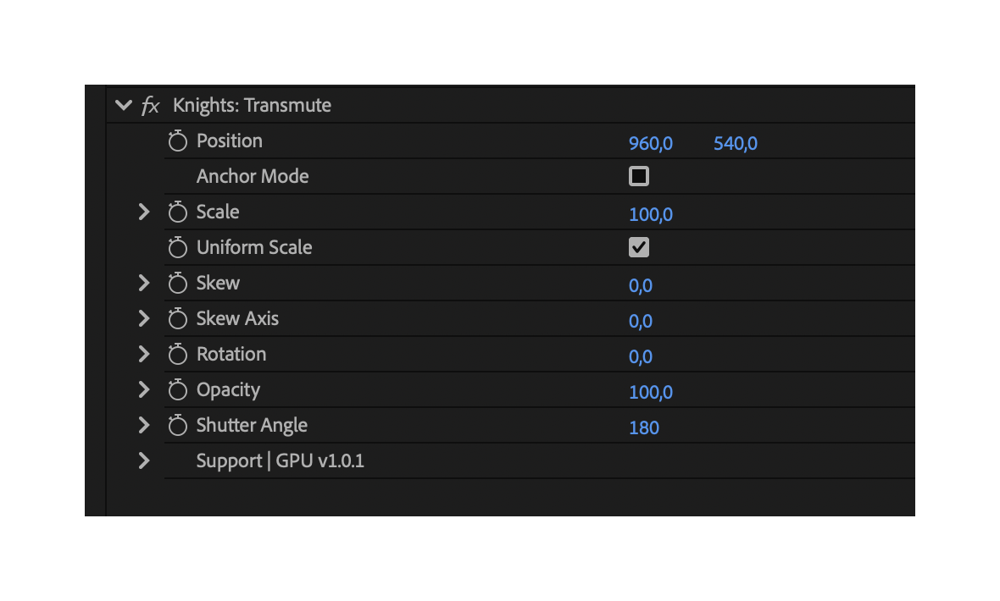
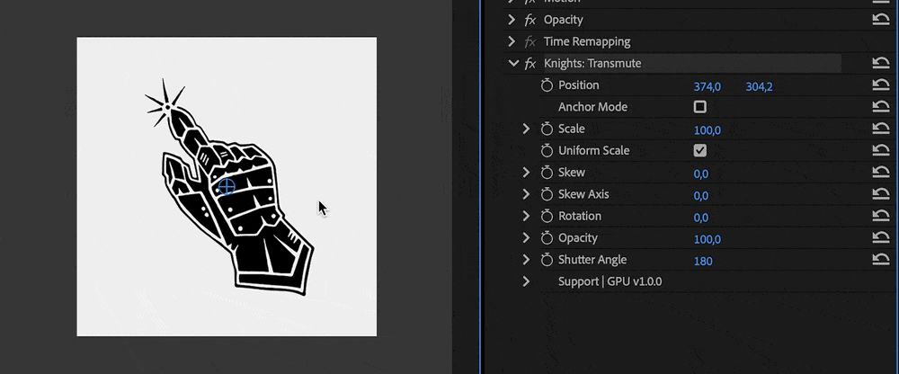
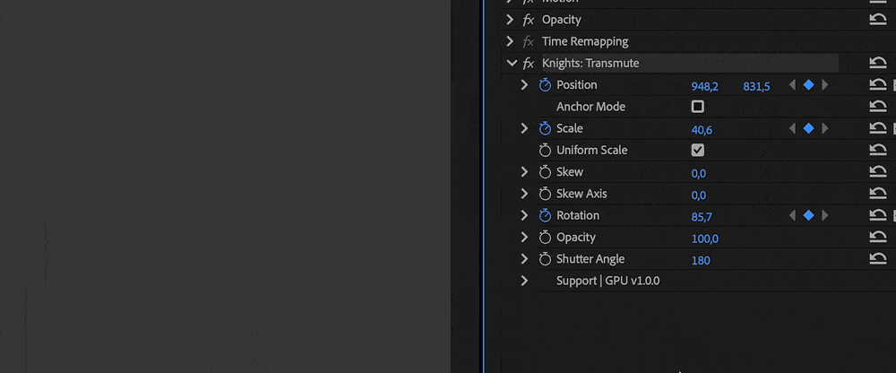
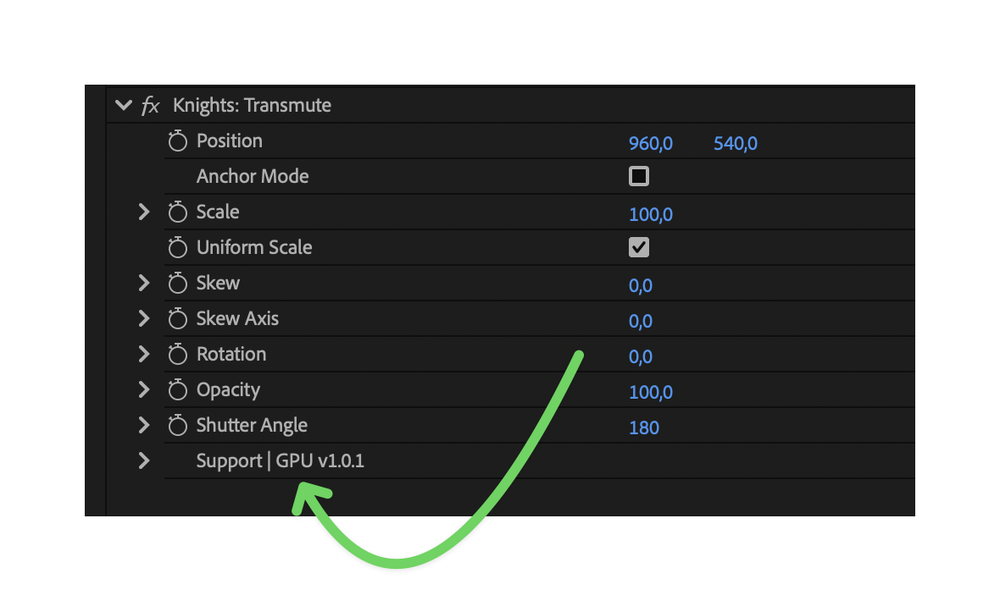

---
layout:
  width: default
  title:
    visible: true
  description:
    visible: false
  tableOfContents:
    visible: true
  outline:
    visible: true
  pagination:
    visible: true
  metadata:
    visible: true
  tags:
    visible: true
  actions:
    visible: true
  anchors:
    visible: true
---

# How it works

## Properties

Transmute effect has the same properties as native Transform effect, except Anchor point.

<figure><figcaption></figcaption></figure>

## Anchor Mode

To modify anchor point, enable **Anchor Mode,** and drag crosshair in Program Monitor or change position value in Effect Controls.

<figure><figcaption></figcaption></figure>

## Motion Blur

Transmute effect has motion blur, to control it, modify Shutter Angle property.

<figure><figcaption></figcaption></figure>

## GPU support

Transmute effect has GPU support. To verify, check if Support label shows GPU or CPU.

<figure><figcaption></figcaption></figure>
