# Clip

## Position, Scale, Rotation, Anchor Point, Anti-flicker Filter, Opacity, Volume

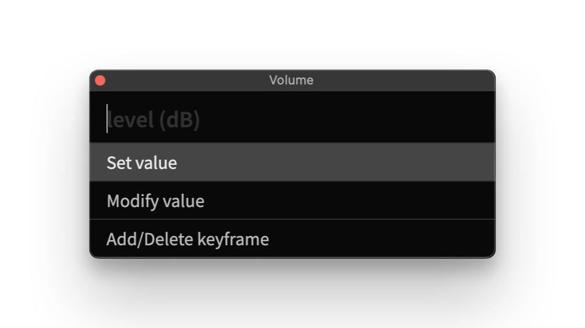

### Set value

Replaces existing value with a new one. If property has stopwatch enabled, linear keyframe will be created.

### Add value

Adds, subtracts, multiplies, divides or takes percentage from existing value. If property has stopwatch enabled, linear keyframe will be created.

| Operation | Symbol      |
| --------- | ----------- |
| Add       | + (or none) |
| Subtract  | -           |
| Multiply  | \*          |
| Divide    | /           |
| Percent   | %           |


Create two User Commands for scale, using **add value** setting:\
`scale_up: +5`  \
`scale_down: -5`\
Assign keyboard for each command. Now it is possible to control clip scale with a keyboard.

Same is useful for position, rotation and other properties.


### Add/Delete keyframe

Works the same way as in After Effects.\
If there is no keyframe at playhead position, it will be created.\
If a stopwatch is inactive, it will be activated, and a keyframe will be created.

If keyframe exists at playhead, it will be deleted.\
If no keyframes left, a stopwatch will be deactivated.

## Blend Mode

Changes blend mode of selected clips.

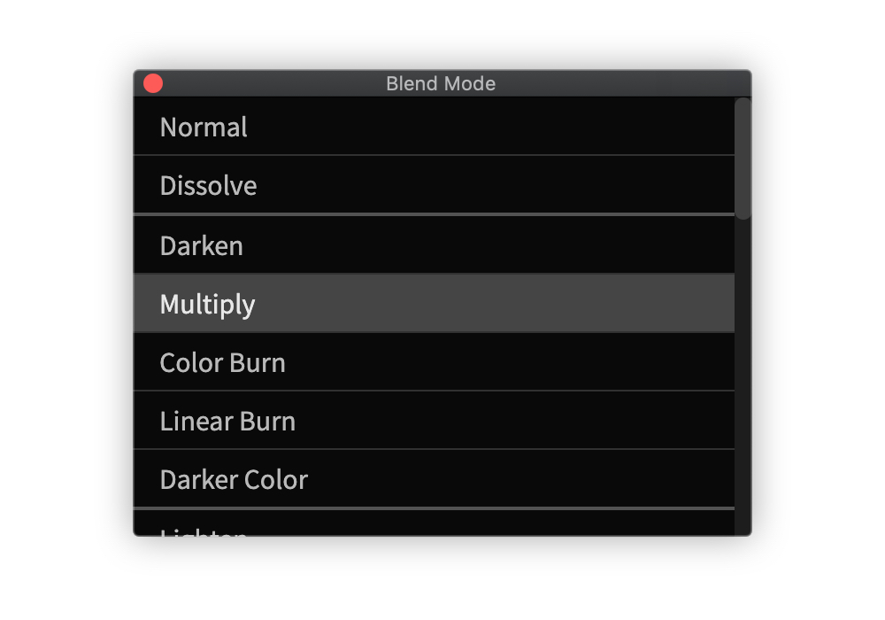

## Speed

* **Change Speed** — duration is not affected
* **Change Speed and Duration** — duration is linked to speed change
* **Change Speed and Duration**, **Ripple Edit** — trailing clips will shift, left or right depending on duration change

.gif>)

## Duration

Changes duration of selected clip, without affecting its speed.

### Ripple Edit OFF

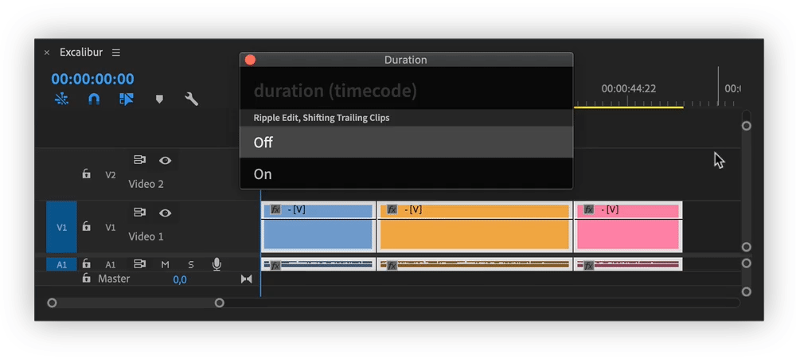

### Ripple Edit ON

To keep the clips following the changing clips next to them.

## Reverse

Reverses clip

## Rename

Renames clip.\
If multiple clips are selected, all clips will get same name.

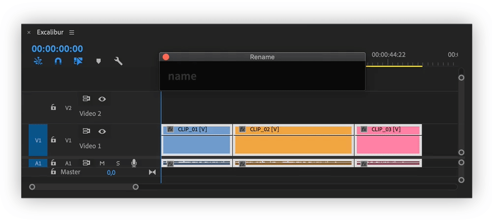

## Fill Frame

Scales clip, so it fills frame.

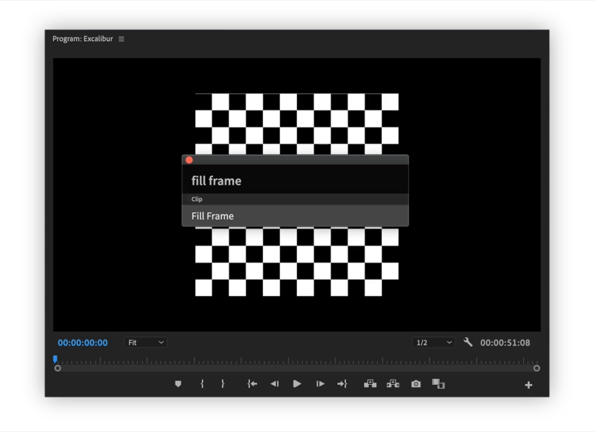

## Label

Change label of selected clips. List shows label colors and names, that were set in Premiere Pro preferences.

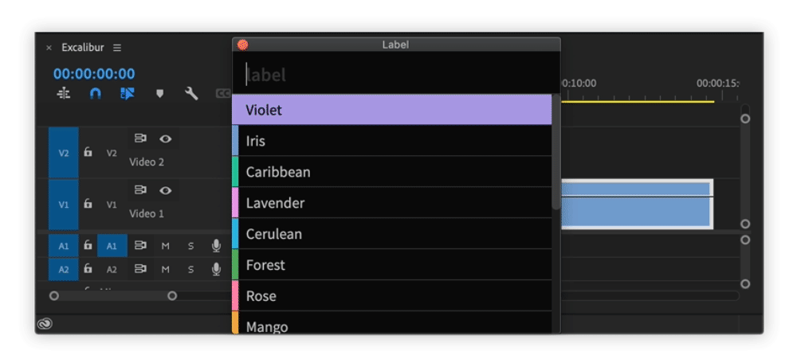

## Move to Track

Move selected clips to a track.\
You can specify track by its name, index or calculate index (e.g. `+3` or `-2` ).

If destination track is occupied, clip will be moved to the next free track.

<figure>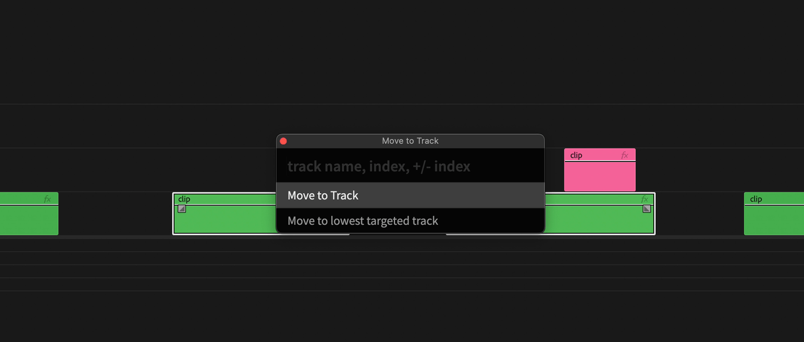<figcaption></figcaption></figure>

## Copy to Track

Copy selected clips to a track.\
You can specify track by its name, index or calculate index (e.g. `+3` or `-2` ).

If destination track is occupied, clip will be copied to the next free track.

<figure><figcaption></figcaption></figure>

## Paste Clip

Pastes clips from clipboard to specified track:

* overlay (paste on the next free track)
* on the same track
* on the highest enabled track
* on the lowest enabled track

<figure>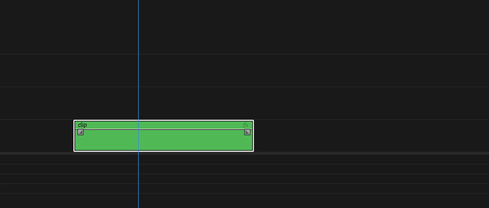<figcaption></figcaption></figure>

## Remember/Restore selection

Remember selection of clips and restore it afterwards. Selection is saved per sequence.

<figure>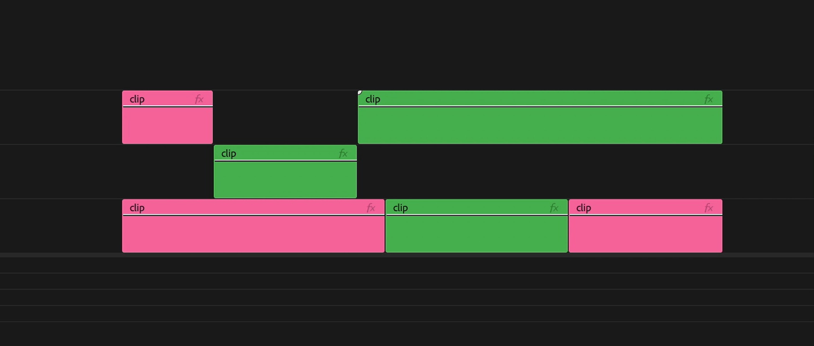<figcaption></figcaption></figure>


Remember selection is useful for user commands, where you need to get back to original selection, e.g.:\
\- remember selection\
\- copy clips to another track\
\- modify copied clips (effects, labels, etc)\
\- restore selection\
\- modifiy original clips


## Nest Clips

Creates nested sequence from selected clips and moves it to "Nested Clips" bin.

By default nested sequence named:\
`ParentSequenceName_nest_counter`

### Premiere Pro nest

Uses native nest command.

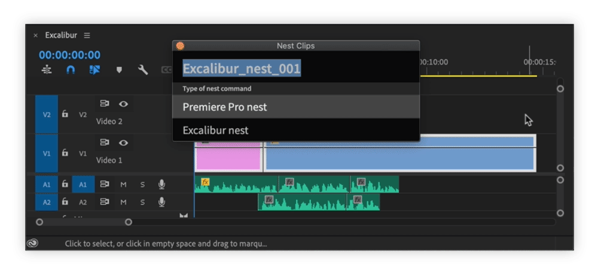

### Excalibur nest

API method to nest clips. Allows to nest audio clips.

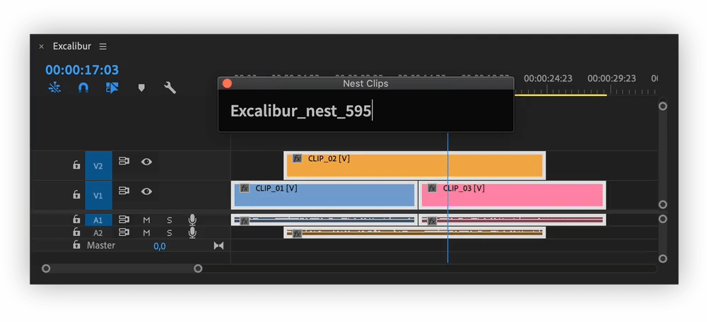

## Nest Individual Clips

Creates nested sequences from **each** selected clip and moves it to "Nested Clips" bin. Linked clips will be nested together.

By default nested sequences named:\
`ParentSequenceName_ClipName_nest_counter`

### Premiere Pro nest

Uses native nest command.

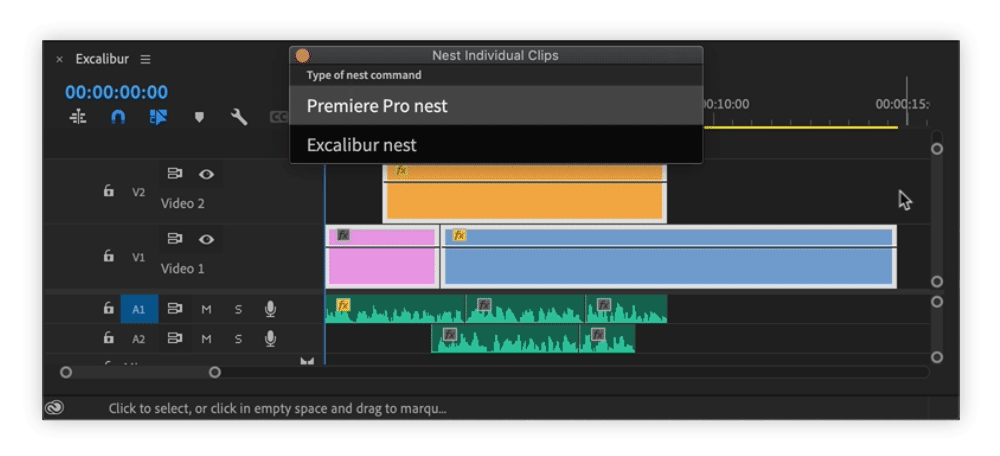

### Excalibur nest

API method to nest clips. Allows to nest audio clips.

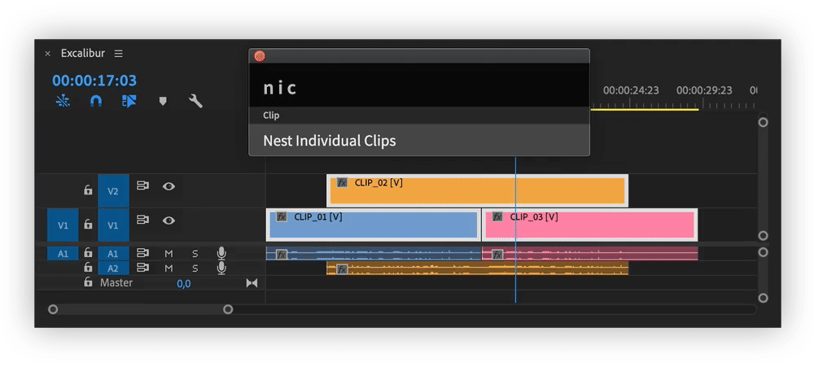

## Trim In/Out Point to Playhead

Trims In/Out Point of selected clips to Playhead.

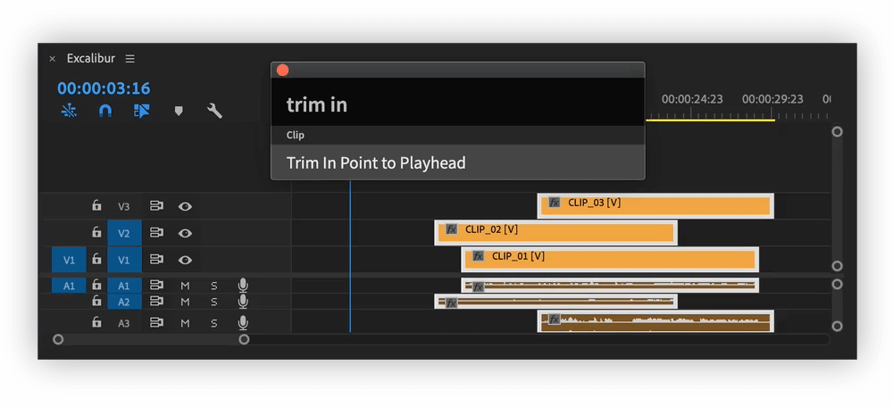

If there is already another clip at playhead position, trim will be performed to End/Start of this clip.

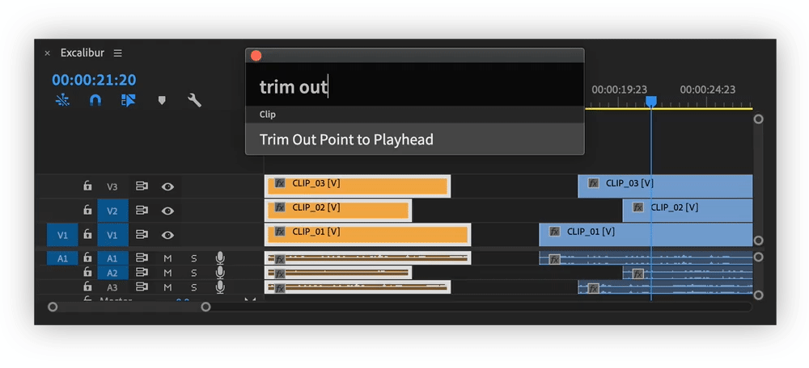


**UI bug**: after performing command some selected clips might look like they are not selected.


## Move Clip Start/End to Playhead

Moves clips Start/End to Playhead.

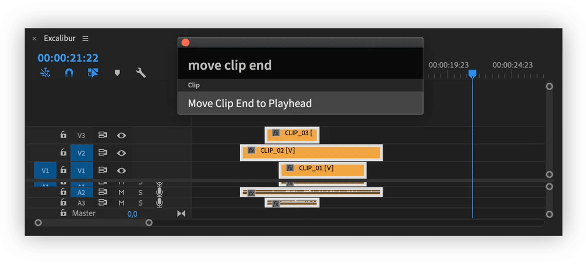

If there is already another clip at playhead position, move will be performed to End/Start of this clip.

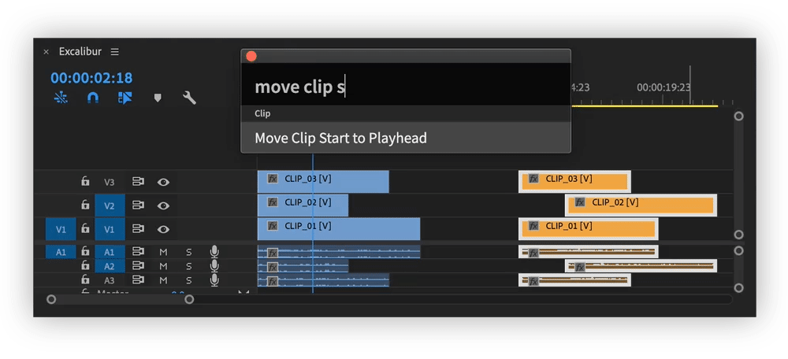

## Remove Transitions

Removes transitions from selected clips or whole sequence

### From Selected Clips

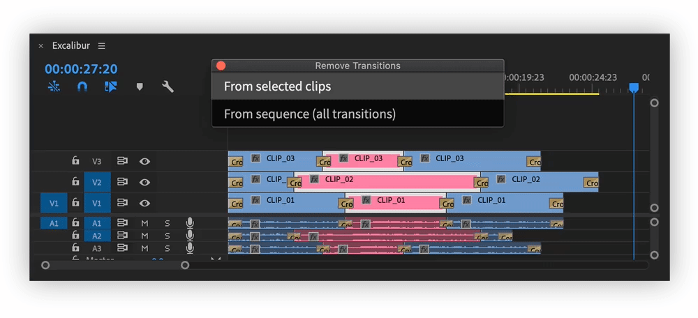

### From Sequence (all transitions)

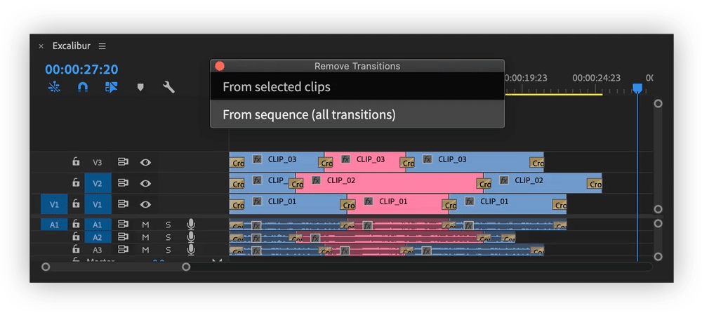

## **Show Clip Keyframes**

Simulates right click on a clip and clicks on a selected menu.

How to use:\
Place coursor on top of a video clip (**don’t move it after that**), call up Excalibur search bar and select menu item needed.\
It is advised to create User command and assign shortcut to it.

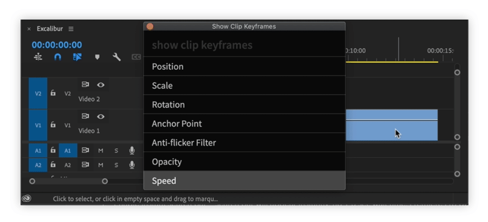
