# Sequence

## Open Sequence

Shows list of all sequences in the project and opens selected one.

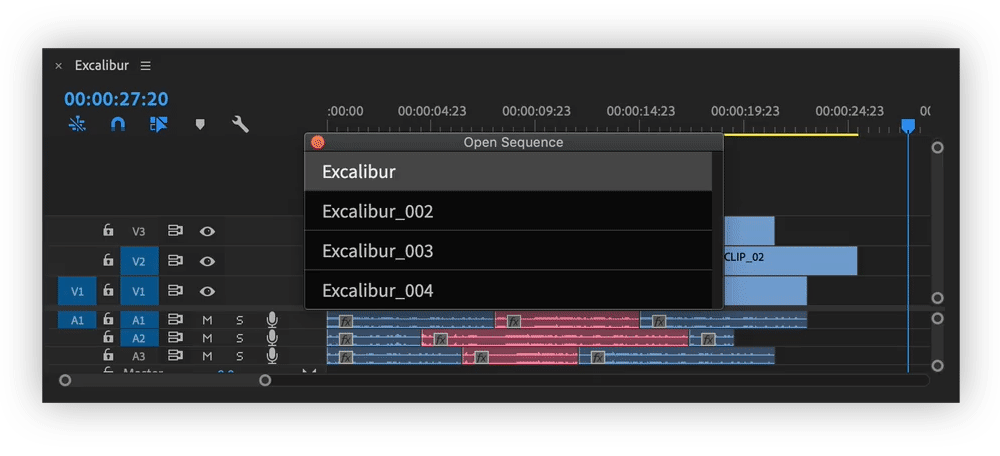

## Duplicate and Increment

Duplicates active sequence to "Archived Sequences" bin and opens new (identical) sequence with incremented name.

| Before            | After             |
| ----------------- | ----------------- |
| SequenceName\_006 | SequenceName\_007 |

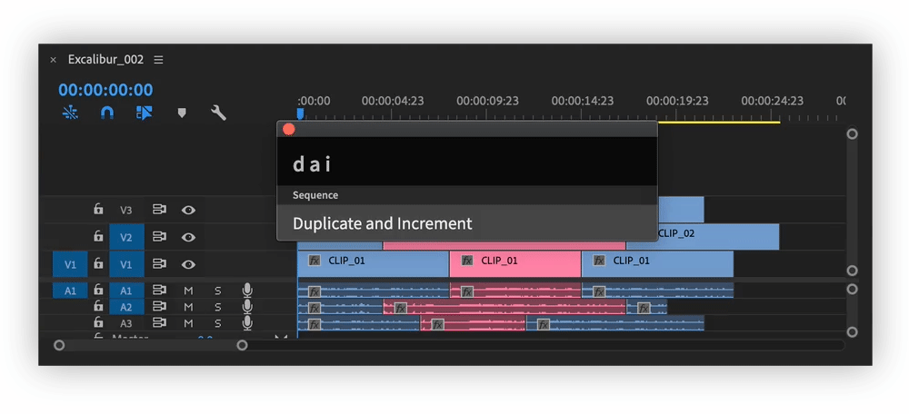

## Add Marker to Sequence

Adds marker to active sequence with specified name and label colour at playhead position.

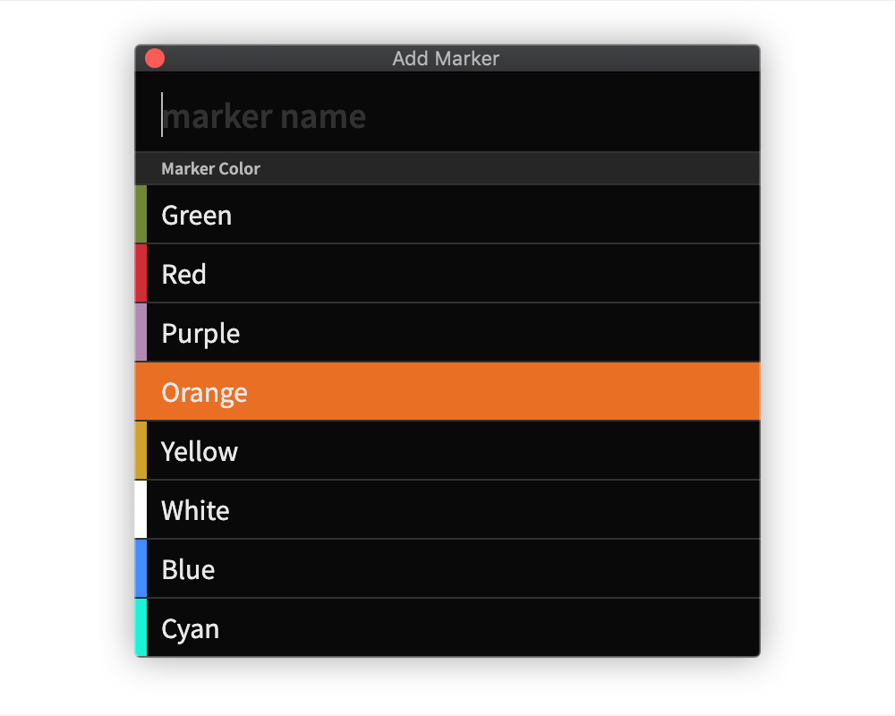

## Add Marker to Selection

Adds marker to active sequence with specified name and label colour, which has duration of current selection.

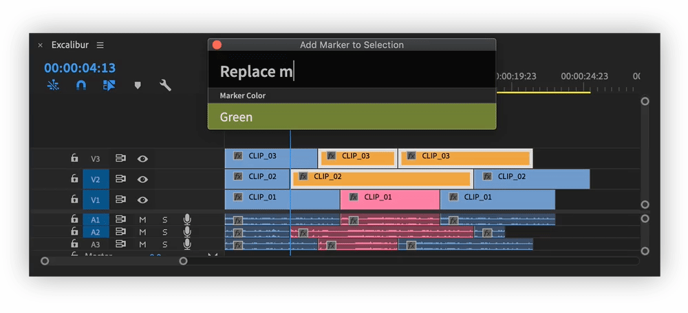

## Add Marker to Clip

Adds marker to a clip with specified name and label colour, which has duration of the selected clip.

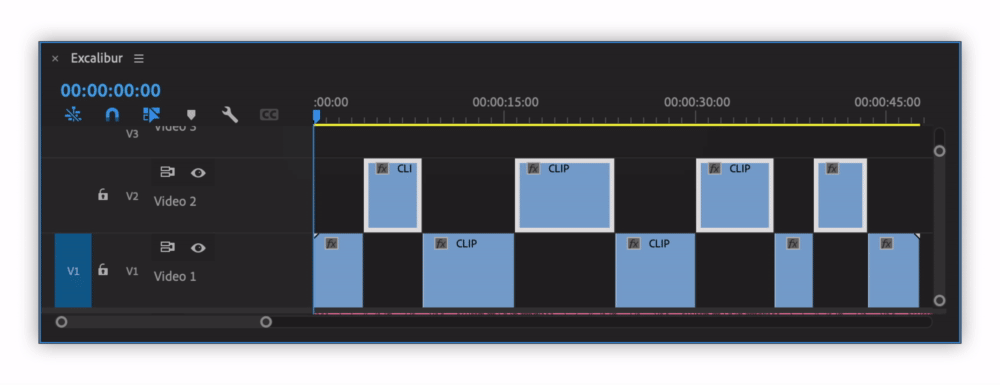

## Target Video/Audio Tracks

Targets specified tracks.

| **Option**                            | Behaviour                                                                          |
| ------------------------------------- | ---------------------------------------------------------------------------------- |
| **Target tracks**                     | Number input, targets **specified tracks\***, additive behaviour                   |
| **Toggle tracks**                     | Number input, toggles only **specified tracks\***                                  |
| **Target tracks with selected clips** | Targets tracks with selected clips, additive behaviour                             |
| **Toggle tracks with selected clips** | Toggles only tracks with selected clips                                            |
| **Target All tracks**                 | Targets all tracks                                                                 |
| **Toggle All tracks**                 | Toggles all tracks. If at least one track is targeted, will toggle all tracks off. |
| **un-Target All tracks**              | Toggles all tracks off.                                                            |

**\*** To affect multiple tracks, type track numbers separated by comma

## Mute Video/Audio Tracks

Mutes specified tracks. For list of options look at [Target Video/Audio Tracks](sequence.md#target-video-audio-tracks).

## Lock Video/Audio Tracks

Locks specified tracks. For list of options look at [Target Video/Audio Tracks](sequence.md#target-video-audio-tracks).

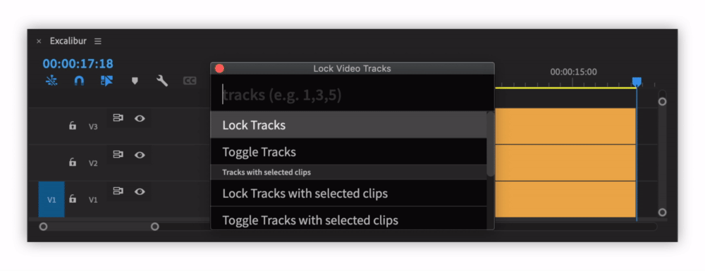

## Sync Lock Video/Audio Tracks

Sync Locks specified tracks. For list of options look at [Target Video/Audio Tracks](sequence.md#target-video-audio-tracks).

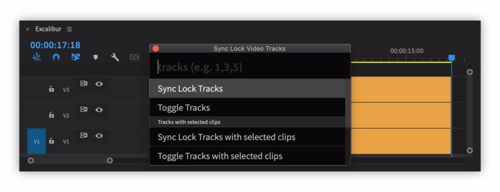

## Solo Mute Tracks

Toggles off track output/mutes all tracks except ones that have clips selected.

Submenu has options to use this command for:

* All tracks
* Video tracks
* Audio tracks

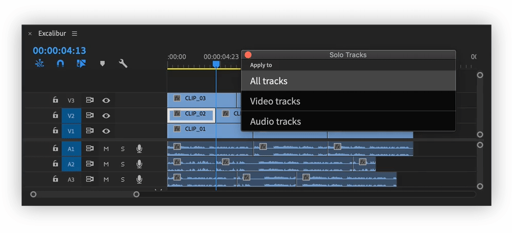

After "Solo Mute Tracks" command was used, it will appear as "un-Solo Mute Tracks", executing it will reset toggles/mutes to original value.

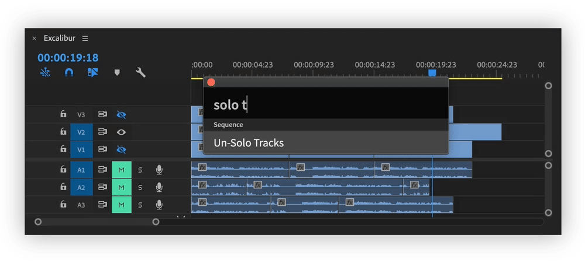

## Solo Lock Tracks

Locks all tracks except ones that have clips selected.

Submenu has options to use this command for:

* All tracks
* Video tracks
* Audio tracks

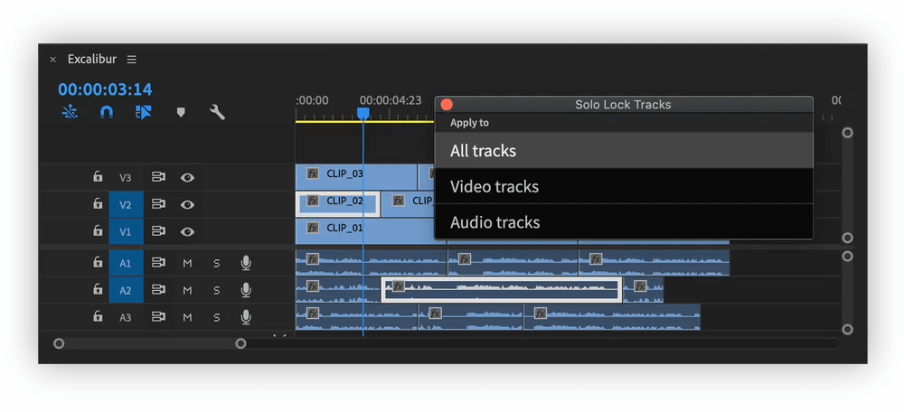

After "Solo Lock Tracks" command was used, it will appear as "un-Solo Lock Tracks", executing it will reset locks to original value.

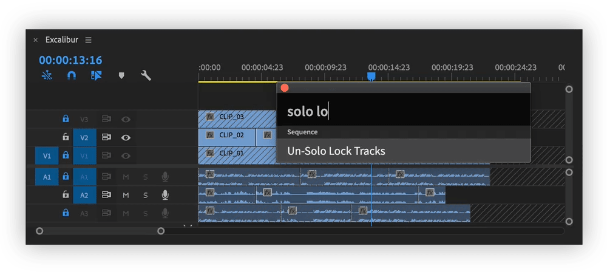

## New Item

Will create syntetic media file, with same settings as active sequence and add it on the first empty track after the lowest targeted track (overlay).

Available Items:

* Adjustment layer
* Color Matte
* Black Video
* Transparent Video
* Bars and Tone

<figure>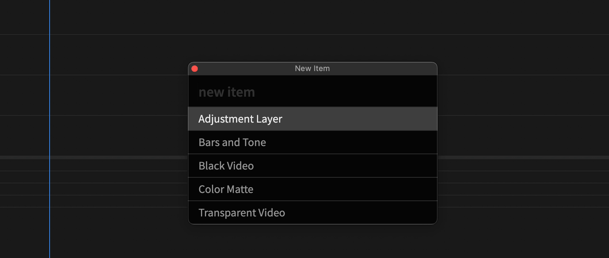<figcaption></figcaption></figure>

### Overwrite

In user command It is possible to use overwrite option, so clip will be added on the lowest targeted track overwriting any clips on it.

<figure>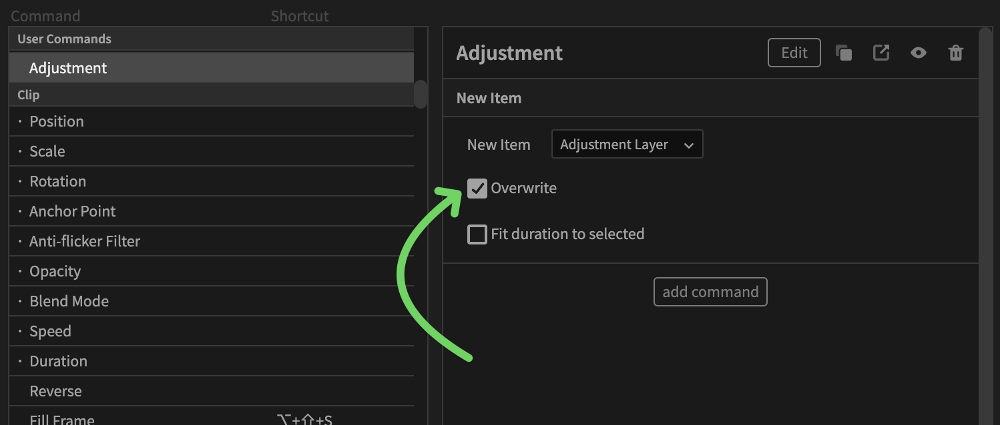<figcaption></figcaption></figure>

### Fit duration to selected

Enable "Fit duration to selected" in user command and duration of new item will match duration of selected clips.

<figure>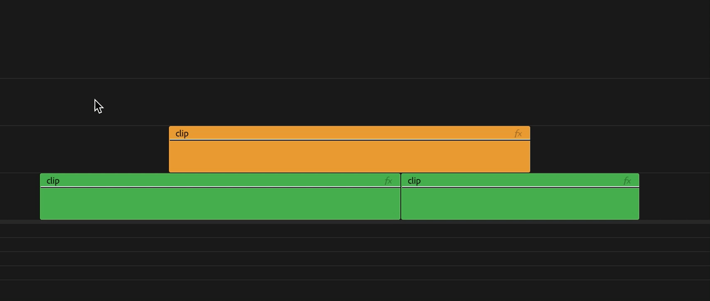<figcaption></figcaption></figure>

## Match Frame to Source Sequence

Match frame from active sequence to sequence in source monitor.

This command also works between Production projects.


Source sequence should be loaded in source monitor for this command to work.


## Reverse Match Frame

Match frame from source monitor to active sequence. Works with sequences and media files loaded in source monitor.

This command also works between Production projects.

## Move Playhead

Move playhead to specific or calculated timecode. Works the same way as [Timecode](timecode.md).


Useful for user commands to create keyframe automations.

