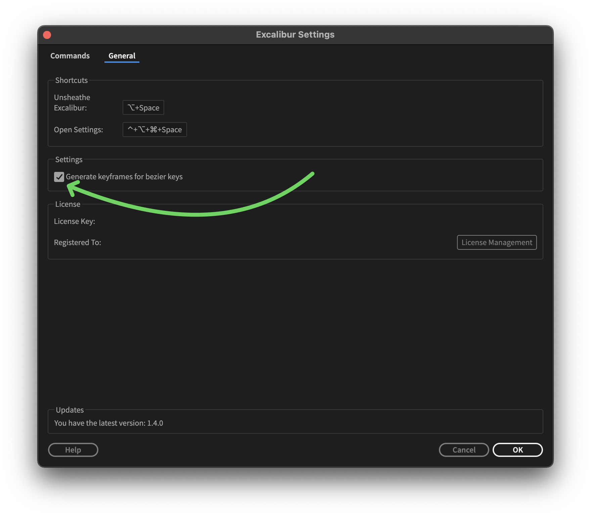

# General

In general tab you can assign shortcuts to launch Excalibur search bar (**Unsheathe Excalibur**) or to open settings.

If update will be available, the download link will appear at the bottom.

### Bezier keyframes

Enable "Generate keyframes for bezier keys" as a workaround for [bezier keyframes limitation](../limitations.md#bezier-keyframes).

<figure><figcaption></figcaption></figure>
