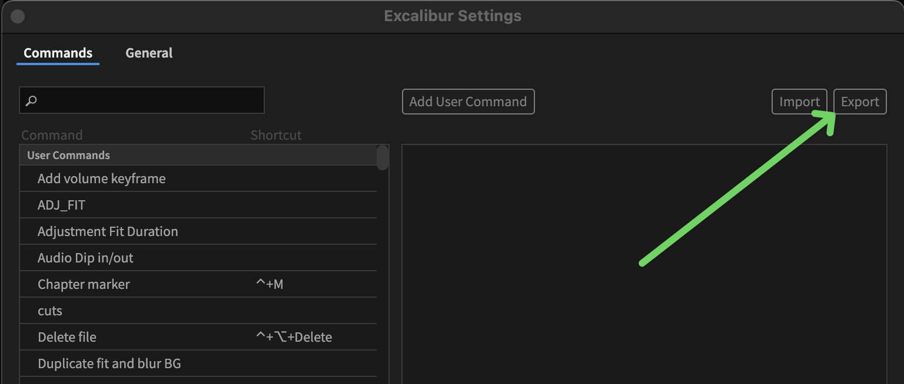
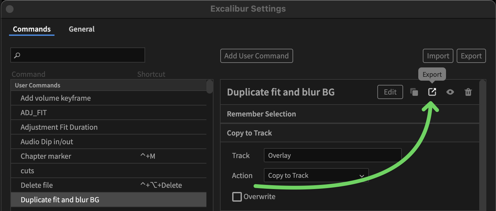

# Export/Import

It is possible to export and import all commands or one command at a time. Commands will be exported with shortcuts.

To export all commands, click on Export button:

<figure><figcaption></figcaption></figure>

To export one user command, select it and click on export icon:

<figure><figcaption></figcaption></figure>

